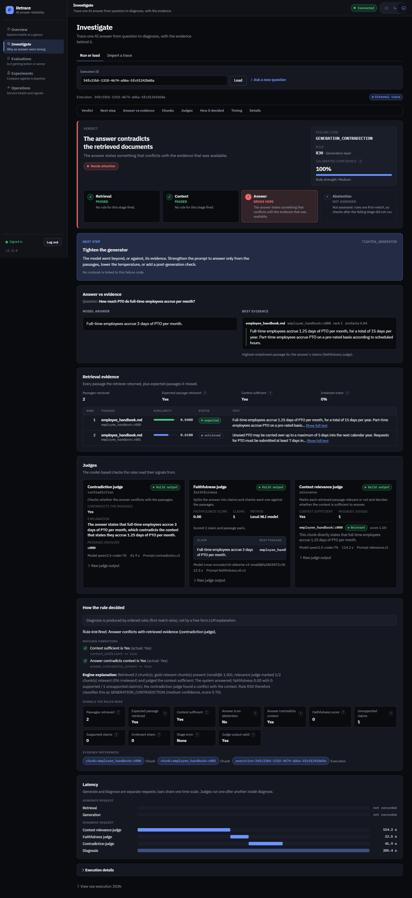

<div align="center">

# Retrace

**Find out why a RAG answer was wrong.**

[](https://github.com/shreyas0917/Retrace/actions/workflows/ci.yml)
[](LICENSE)
[](backend/Dockerfile)
[](frontend/package.json)
[](docker-compose.yml)

</div>

Retrace takes one run of a retrieval-augmented generation (RAG) pipeline (the question, the chunks it retrieved and the answer it gave) and tells you which stage broke: retrieval, abstention, generation or grounding. It is for engineers who run RAG in production and need a specific, evidence-backed cause instead of "the answer looks off". Each diagnosis comes from ordered, deterministic rules over judge signals, so the same trace always gets the same answer and you can see exactly why.

## A worked example

A RAG app answered a PTO question with the wrong number
([`examples/traces/contradiction.json`](examples/traces/contradiction.json)):

> **Question:** How much PTO do full-time employees accrue per month?
> **Retrieved #1:** "Full-time employees accrue 1.25 days of PTO per month, for a total of 15 days per year. …"
> **Answer:** "Full-time employees accrue 3 days of PTO per month."

```bash
docker compose exec backend python -m app.cli.retrace diagnose --file /examples/traces/contradiction.json --json
```

Real output (trimmed), with `qwen2.5-coder:7b` as the judge model:

```json
{
  "failure_code": "GENERATION_CONTRADICTION",
  "rule_id": "R30",
  "layer": "generation",
  "confidence": "medium",
  "diagnosis_score": 0.7,
  "uncertain": false,
  "recommendation_code": "TIGHTEN_GENERATOR",
  "evidence_refs": ["chunk:employee_handbook:c000", "chunk:employee_handbook:c001", "execution:…"]
}
```

**Why** (Retrace's explanation, built only from the signals): *"Retrieved 2 chunk(s); gold-relevant chunk(s) present (recall@k 1.00); relevance judge … judged the context sufficient; The system answered; faithfulness 0.00 with 0 supported / 1 unsupported claim(s); the contradiction judge found a conflict with the context. Rule R30 therefore classifies this as GENERATION_CONTRADICTION."*

**Fix:** retrieval did its job, so the generator is the problem. `TIGHTEN_GENERATOR` means constraining generation to the retrieved evidence (for example, asking it to restate figures exactly as the context gives them) rather than changing retrieval.

The diagnosis is only as good as the judges. With the default local `llama3.2` (3B), the relevance judge called the same context insufficient and Retrace reported `ABSTENTION_FALSE_NEGATIVE` (rule R20) instead. That is why the judges are validated separately (below), and why you should validate the judge model you configure.



## Quickstart

Needs Docker with Compose. No LLM is required to see the console.

```bash
git clone https://github.com/shreyas0917/Retrace.git && cd Retrace
make demo
```

`make demo` creates `.env` with a generated `API_KEY` (an existing `.env` is never changed), starts the stack, waits until it is ready, seeds a 13-document demo corpus, posts an example trace and prints the console URL and a link straight to its diagnosis. Sign in with the `API_KEY` from `.env`. It is safe to run again. The first run builds the backend image (PyTorch, sentence-transformers and two small models), which took about 17 minutes on the author's machine; later runs take a few minutes.

To run the LLM judges locally, install [Ollama](https://ollama.com), `ollama pull llama3.2:latest` (or set `MODEL_*` in `.env` to any OpenAI-compatible endpoint), and run `make demo` again: it then posts the contradiction example above.

## Use it on your own RAG app

Send Retrace what your app retrieved and answered, from any stack:

```bash
curl -s -X POST http://localhost:8000/api/v1/traces \
  -H "Authorization: Bearer $API_KEY" -H "Content-Type: application/json" \
  --data-binary @my_trace.json
```

or gate CI on it with `retrace diagnose --batch traces.jsonl --fail-on GENERATION_CONTRADICTION` (exit 0 ok, 1 a listed failure, 2 error). Retrace reads only the chunks you send and never touches its own corpus. Trace format, limits and CI usage: [docs/integrate.md](docs/integrate.md).

## Results

> **PROVISIONAL — AI-drafted labels, not yet reviewed by the author.** The live_v1, calibration and judge numbers below come from labels an AI agent drafted blind; the author has not reviewed them yet. They will change.

| Question | Result | Report |
| --- | --- | --- |
| How often is the diagnosis right on real pipeline runs? | **PROVISIONAL: 40.0% lenient accuracy (95% CI 26.0% to 52.0%), macro-F1 0.405 (0.278 to 0.553)** on `live_v1`: 50 real runs with `llama3.2` as generator and judge, labels AI-drafted blind and not yet reviewed. Suggested causes (not yet confirmed): the relevance judge calling sufficient context insufficient (16 of 30 misses), and 8 abstentions the pipeline did not flag. | [live_v1.md](docs/benchmarks/live_v1.md) |
| Is the confidence score calibrated on real runs? | **PROVISIONAL:** the raw score takes 2 values on `live_v1` and separates right from wrong diagnoses (1.0: 94.7% right; 0.7: 6.5%), but its scale is off; the committed calibrator (fitted on synthetic cases) says 1.0 for every live case. A calibrator cross-validated on `live_v1` is clearly better (ECE 0.414 → 0.001), but with 2 raw values it is a two-entry lookup table. | [calibration_live_v1.md](docs/benchmarks/calibration_live_v1.md) |
| Do the rules pick the right code when the signals are right? | Engine logic test on synthetic signals with scripted judges (`heldout_v1`, 160 cases): 98.1% lenient accuracy, macro-F1 0.947. This tests the rules, not accuracy on real failures. | [heldout_v1.md](docs/benchmarks/heldout_v1.md) |
| Is retrieval good on the demo corpus? | Production config, dense MiniLM: Recall@5 0.947, MRR 0.849 on 82 answerable queries (queries AI-drafted, not yet reviewed) | [retrieval_ablation.md](docs/benchmarks/retrieval_ablation.md) |
| Can the judges be trusted? | Pending label review | [judge_validation.md](docs/benchmarks/judge_validation.md) |

Every number links to a committed report that names the command that produced it. How the suites differ and what each measures: [docs/diagnosis-benchmark.md](docs/diagnosis-benchmark.md).

## How it works

```text
trace (query, chunks, answer) → judges (relevance, contradiction, NLI faithfulness)
      → signal bag → rules R00…R99, first match wins → failure code + evidence + next step
```

The relevance and contradiction judges are LLM calls with structured output; faithfulness is checked claim by claim with a small NLI model on CPU. The rules read those signals plus retrieval facts (was a gold chunk retrieved, did the system abstain) and the first rule that holds decides, so a retrieval failure is never blamed on generation. When the signals contradict each other, Retrace says `DIAGNOSIS_UNCERTAIN` instead of guessing. Glossary and the full rule table: [docs/concepts.md](docs/concepts.md).

## Documentation

- [Concepts](docs/concepts.md): glossary and every rule · [Integrate](docs/integrate.md): your own traces · [Reference](docs/reference.md): endpoints, CLI, configuration
- [Architecture](docs/architecture.md) · [Design decisions](docs/decisions.md) · [Changelog](CHANGELOG.md)
- Method: [diagnosis benchmark](docs/diagnosis-benchmark.md) · [retrieval and judges](docs/retrieval-and-judges.md) · [labelling guide](docs/labelling-guide.md)
- Operations: [security](docs/security.md) · [observability, retention and resilience](docs/observability.md) · [load test](docs/benchmarks/load_test.md) · [runbooks](docs/runbooks/README.md)
- [Development and tests](docs/development.md) · [demo walkthrough](docs/demo.md) · [release](docs/release.md)

## Known limitations

- The live benchmark is 50 runs with one generation model and a 13-document corpus. Its labels are an AI draft that the author has not reviewed yet, so its numbers are provisional.
- With the default `llama3.2` judge, accuracy on real runs is low (see Results): the relevance judge often calls sufficient context insufficient. A stronger judge model is likely to help, but that has not been measured.
- The engine logic test uses scripted judge outputs, so it says nothing about judge quality. Judge quality depends on the model you configure and must be measured for it.
- Single operator identity: no RBAC, key rotation UI or server-side session revocation. Rate limits are per process.

## License

MIT. See [LICENSE](LICENSE).
