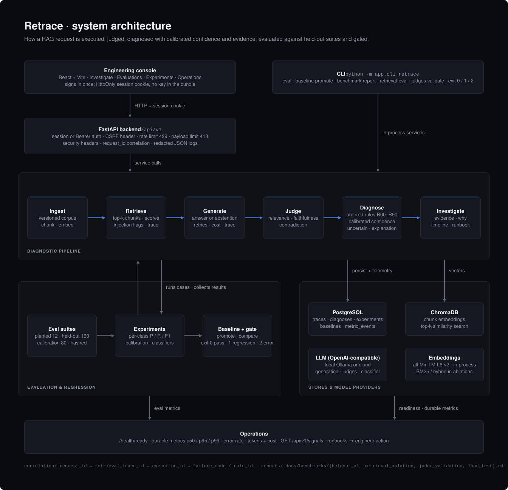

# Architecture



Retrace is a FastAPI service plus a React console that executes retrieval-augmented generation (RAG) requests, judges them, localizes failures with a deterministic rule engine, and measures itself with versioned evaluation suites. Version 1.0 adds session authentication and abuse controls at the edge, an explicit uncertain outcome with calibrated confidence and templated explanations in the diagnosis stage, a held-out benchmark with a classifier comparison, retrieval and judge measurements, durable telemetry with cost accounting, and fault-injection and load testing.

## Request flow

```text
Console (session cookie) ─┐
                          ├─► FastAPI /api/v1 ─► services ─► pipeline
CLI (Bearer, in-process) ─┘        │
                                   ├─ auth (session or Bearer) · CSRF header · rate limit · payload limit · security headers
                                   └─ request_id correlation · redacted JSON logs · telemetry flush

Query → Retrieve (top-k, injection flags) → Generate (retries, tokens, cost) → Judges
      → Diagnose (rules R00–R90, calibrated confidence, uncertain flag, explanation)
      → Investigate (evidence, why, timeline, runbook)
```

## Components

| Component | Responsibility | Key modules |
| --- | --- | --- |
| Edge | Session login, dual auth dependency, CSRF guard, sliding-window rate limit, payload limit, security headers, input validation | `core/security.py`, `core/ratelimit.py`, `core/hardening.py`, `api/routes_auth.py`, `schemas/` |
| Retrieval | Versioned ingest, chunking, MiniLM embeddings, Chroma cosine top-k, retrieval trace, prompt-injection flags | `services/ingestion.py`, `services/retrieval.py`, `core/injection.py` |
| Generation | OpenAI-compatible client with connect/read timeouts, bounded retries on 429/5xx, token usage and cost per execution | `services/llm_client.py`, `services/rag.py`, `services/pricing.py` |
| Judges | Relevance, faithfulness, contradiction; structured JSON, one retry, versioned prompts | `services/judges/` |
| Diagnosis | Ordered rules, `DIAGNOSIS_UNCERTAIN` (R90), histogram calibration, templated explanation, evidence refs | `services/diagnosis/` |
| Evaluation | Suites (planted, held-out, calibration, gold), experiments, per-class metrics, baselines, regression gate, classifier comparison | `services/eval/`, `services/metrics/diagnosis.py`, `cli/benchmark_cmd.py` |
| Measurement | Retrieval ablation (Recall@k, MRR, nDCG; chunking, dense vs BM25 vs hybrid), judge validation (labels, kappa, prompt sensitivity) | `services/retrieval_eval.py`, `services/judges/validation.py` |
| Observability | In-memory fast path plus durable `metric_events` in PostgreSQL; p50/p95/p99, error rates, tokens, cost; signals and runbooks | `core/metrics.py`, `core/telemetry.py`, `core/signals.py`, `api/routes_health.py` |
| Console | Investigate, Evaluations, Experiments, Operations; login panel; per-class tables; durable metrics panel | `frontend/src/` |

## Diagnosis engine

Rules are evaluated in order; the first match is the primary code.

| Order | Rule | Result |
| --- | --- | --- |
| Infrastructure | R00, R01, R02 | timeout, malformed judge, missing context |
| Retrieval | R10, R11, R12 | empty, gold miss, distractor dominant |
| Abstention | R14, R20, R21 | correct abstention, false negative, false positive |
| Grounding / generation | R30, R33, R31, R34, R40 | contradiction, partial, hallucination, unsupported, grounded |
| Uncertain (v1.0) | R90 | judge outputs inconsistent or missing → `DIAGNOSIS_UNCERTAIN`, `MANUAL_REVIEW` |
| Fallback | R99 | internal error |

After the rule fires, the engine attaches a calibrated confidence (histogram binning fitted on `calib_v1`, stored in `configs/calibration.json`), sets `uncertain` when that probability is below 0.5 or the code is `DIAGNOSIS_UNCERTAIN`, and builds a templated explanation from the signals. All three are persisted in `diagnoses.signals` and returned by the diagnose and investigation APIs. Details: [diagnosis-benchmark.md](diagnosis-benchmark.md).

## Evaluation and benchmarks

| Suite | Cases | Role |
| --- | ---: | --- |
| `planted_v1` | 12 | One scenario per failure class; CI gate with a 2% error ceiling |
| `heldout_v1` | 160 | Generated from scenario semantics, 15% boundary cases; per-class P/R/F1, calibration check, classifier comparison |
| `calib_v1` | 80 | Fits the calibrator; disjoint from the held-out suite |
| `gold_v1` | 2 | Hand-written offline executions |

`retrace eval` runs a suite, persists an experiment with per-class metrics, compares it with the active baseline using per-suite thresholds and exits 0 / 1 / 2. `retrace benchmark report` additionally fits the calibrator, measures calibration error, and compares the rule engine with majority, heuristic and LLM classifiers on identical persisted signal bags. Reports are committed under `docs/benchmarks/`.

## Investigation API

`GET /api/v1/investigations/{execution_id}` aggregates execution and generation metadata, the diagnosis (code, rule, confidence, calibrated confidence, uncertain flag, explanation), the rule catalog entry, enriched retrieval chunks (`retrieved` / `expected` / `relevant` / `distractor` / `missing`, plus `injection_flags`), judge results, evidence rows and a latency timeline. Supporting: `GET /api/v1/rules`, `GET /api/v1/runbooks`.

## Security model

Single-operator identity with two credentials: the console exchanges the API key once for a short-lived HMAC-signed HttpOnly cookie (`POST /api/v1/auth/session`); automation keeps `Authorization: Bearer`. Cookie-authenticated writes must carry `X-Requested-With: retrace-console`. Per-credential rate limits, payload limits, query validation, security headers, injection flags and log redaction complete the edge. Full threat model: [security.md](security.md).

## Observability

```text
HTTP / RAG / judges / diagnosis / eval
 ↓ structured JSON logs (redacted)
 ↓ in-memory registry (fast path)  +  metric_events in PostgreSQL (durable, flushed per request)
 ↓ GET /metrics · GET /api/v1/metrics/durable?window_minutes= · GET /api/v1/signals · GET /api/v1/ops/summary
 ↓ runbooks → engineer action
```

Durable aggregates include p50/p95/p99 latency per operation, request error rate, retrieval and judge failure rates, token usage and estimated cost (`configs/pricing.yaml`). Design and retention notes: [observability.md](observability.md). Load and fault-injection results: [benchmarks/load_test.md](benchmarks/load_test.md), `backend/tests/test_resilience.py`.

## Correlation

```text
request_id → retrieval_trace_id → execution_id → failure_code / rule_id
experiment_id → case_id → execution_id → investigation
```

## Health

| Endpoint | Meaning |
| --- | --- |
| `/health/live` | Liveness |
| `/health/ready` | Postgres + Chroma |
| `/api/v1/auth/me` | Current session state |

## Limitations

- Held-out and planted suites use scripted judge outputs; they measure the diagnosis engine, not live-LLM robustness. Judge quality is measured separately and depends on the model.
- Rate limiting is per process; the durable metric store is shared across workers but in-memory counters are not.
- Single operator identity; no RBAC, key rotation UI or server-side session revocation.
- Load-test numbers come from one developer machine with a single uvicorn worker.

## Out of scope

Kubernetes, Datadog, Langfuse, a Prometheus server, agents, auto-remediation.
